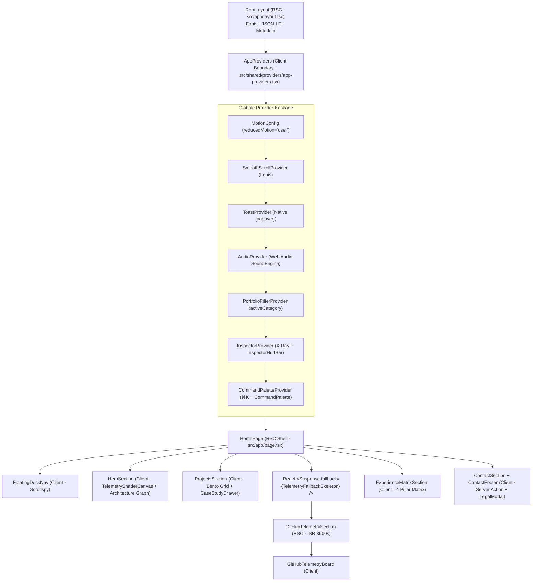

# System- & Software-Architektur (`docs/ARCHITECTURE.md`)

Dieses Dokument beschreibt die interne Architektur von **florian-portfolio**, die Abgrenzung der Layer nach Feature-Sliced Design sowie verbindliche Patterns zur Erweiterung der Core-Systeme (**X-Ray Inspector**, **Command Palette**, **Procedural Web Audio**, **WebGL2 GLSL Shader** und **Design-Tokens**).

---

## 1. System-Überblick & Rendering-Architektur

Die Anwendung trennt strikt zwischen **React Server Components (RSC)** für initiales HTML, SEO-Metadaten und serverseitige API-Calls (mit ISR) sowie gezielten **Client Islands** für Interaktivität, Animationen, WebGL und Web Audio.



### Wichtige architektonische Invarianten
1. **Top-Layer-First für Overlays:** `CaseStudyDrawer`, `CommandPalette` und `LegalModal` nutzen native `<dialog>`-Elemente via `createPortal(..., document.body)`. `ToastProvider` nutzt das native HTML `[popover]`-Attribut. Dadurch gibt es keine `z-index`-Kriege mit Sticky-Navigationen oder WebGL-Canvas-Layern.
2. **Synchronisierter globaler Zustand:** Der aktive Projekt-Filter (`PortfolioFilterProvider`) und der X-Ray-Modus (`InspectorProvider`) werden sowohl von lokalen UI-Buttons als auch global von der `CommandPalette` gelesen und mutiert.
3. **Barrierefreiheit als Default:** `MotionConfig reducedMotion="user"`, `useAccessibleMotion()`, `usePrefersReducedMotion()`, `focus-visible`-Ringe, `:user-invalid`/`:user-valid` und ARIA Live-Regions sind fest in den Shared-Primitives verankert.

---

## 2. Ordnerstruktur & Feature-Sliced Design

```text
src/
├── app/                         # Next.js App Router (Routes, Layout, Global CSS, SEO)
│   ├── globals.css              # Design-Tokens (:root, @theme inline) & Top-Layer CSS
│   ├── layout.tsx               # Root RSC, Google Fonts, JSON-LD, OpenGraph
│   ├── not-found.tsx            # 404-Fehlerseite
│   ├── page.tsx                 # Landingpage-Komposition (RSC + Suspense)
│   ├── robots.ts                # Dynamische robots.txt aus SITE_CONFIG
│   └── sitemap.ts               # Dynamische sitemap.xml aus SITE_CONFIG
│
├── config/                      # Single Source of Truth (reine Daten & Types)
│   ├── index.ts                 # Barrel-Export
│   ├── projects.config.ts       # PROJECTS[] & ProjectItem Types
│   └── site.config.ts           # SITE_CONFIG (Owner, Legal, Socials, Nav, Domains)
│
├── features/                    # Fachlich gekapselte Feature-Module
│   ├── index.ts                 # FEATURE_REGISTRY (Metadaten aller Module)
│   ├── types.ts                 # FeatureModuleId, FeatureModuleMeta
│   ├── audio-engine/            # Prozedurale Web Audio API Synthese
│   ├── command-palette/         # ⌘K Command Palette + Command Registry
│   ├── contact/                 # Kontakt-Sektion, actions/sendContactEmail.ts (Zod + Resend), Footer, LegalModal
│   ├── experience/              # 4-Säulen-Engineering-Matrix (SVG Topology + 0px CLS)
│   ├── github-telemetry/        # RSC GitHub API Loader (ISR 3600s + Commit Enrichment) & Switcher Board
│   ├── hero/                    # Hero-Sektion, Foundation Blueprint, System Graph
│   ├── inspector/               # Architecture X-Ray Context, Wrapper & HUD Bar
│   └── projects/                # Bento Grid & Case-Study Drawer
│
└── shared/                      # Domänen-unabhängige Infrastruktur & UI-Primitives
    ├── components/              # FloatingDockNav, MagneticButton, SpotlightCard, TelemetryShaderCanvas
    ├── hooks/                   # usePrefersReducedMotion
    ├── lib/                     # cn() (clsx + tailwind-merge), Motion-Presets (SPRINGS, useAccessibleMotion)
    ├── providers/               # AppProviders, SmoothScrollProvider, PortfolioFilterProvider, ToastProvider
    └── ui/                      # Container, StatusPill
```

### Abhängigkeitsregeln (Import-Richtung)
- **`src/app/`** darf aus `config/`, `features/` und `shared/` importieren.
- **`src/features/<name>/`** darf aus `config/`, `shared/` und öffentlichen Index-Exports stabiler Cross-Cutting-Features (z. B. `@/features/inspector`, `@/features/audio-engine`, `@/features/command-palette`) importieren. Vermeide zirkuläre Imports zwischen Sektion-Features.
- **`src/shared/`** bleibt frei von Business-Inhalten (`SITE_CONFIG`, `PROJECTS`), mit zwei dokumentierten Infrastruktur-Ausnahmen: `AppProviders` (verdrahtet die globalen Feature-Provider) und `TelemetryShaderCanvas` (reagiert direkt auf `useInspector()`).
- **`src/config/`** importiert außer internen Typen nichts aus `features/` oder `shared/`.

### Schritt-für-Schritt: Ein neues Feature-Modul hinzufügen (Beispiel `devlog`)

Angenommen, du möchtest ein neues Modul **`src/features/devlog/`** (z. B. ein Architektur-Log oder ein interaktiver Playground) ergänzen:

1. **Feature-Ordner & öffentliche API anlegen:**
   Lege unter `src/features/devlog/` deine Komponenten sowie eine `index.ts` mit Metadaten an:
   ```ts
   // src/features/devlog/index.ts
   import type { FeatureModuleMeta } from '@/features/types';

   export const DEVLOG_FEATURE_META: FeatureModuleMeta = {
     id: 'devlog',
     label: 'Engineering DevLog',
     phase: 'Phase 6',
     status: 'active',
     description: 'Kurze Architektur-Notizen und System-Postmortems.',
   };

   export { DevlogSection } from './devlog-section';
   ```

2. **Modul-ID im Feature-Registry-Vertrag registrieren:**
   - Erweitere `FeatureModuleId` in `src/features/types.ts` um `'devlog'`.
   - Importiere `DEVLOG_FEATURE_META` in `src/features/index.ts` und füge es zu `FEATURE_REGISTRY` hinzu.

3. **Komponente mit `<InspectableModule>` wrappen:**
   ```tsx
   // src/features/devlog/devlog-section.tsx
   'use client';
   import { InspectableModule } from '@/features/inspector';
   import { Container } from '@/shared/ui/container';

   export function DevlogSection() {
     return (
       <InspectableModule
         as="section"
         id="devlog"
         tabIndex={-1}
         name="DevlogSection"
         layer="Client // Engineering Notes"
         renderMetric="3 Entries"
         tone="client"
         className="scroll-mt-24 border-t border-border-subtle py-16 sm:py-20"
       >
         <Container>{/* Inhalt */}</Container>
       </InspectableModule>
     );
   }
   ```
   *(Wichtig: `id="devlog"`, `tabIndex={-1}` und `scroll-mt-24` ermöglichen sauberes Scrollen & Fokus-Setzen über `FloatingDockNav` und die Command Palette.)*

4. **In Navigation & Seite einbinden:**
   - **Als Sektion auf der Startseite:** Erweitere `NavSectionId` und `SITE_CONFIG.navigation` in `src/config/site.config.ts` (optional: `Navigation` in der `CommandPalette` übernimmt das automatisch) und binde `<DevlogSection />` in `src/app/page.tsx` ein.
   - **Als eigene Route:** Lege `src/app/devlog/page.tsx` an und registriere optional einen Command-Palette-Eintrag (siehe Abschnitt 3.2).

---

## 3. Erklärung der Core-Systeme

### 3.1 X-Ray / Architecture Inspector (`src/features/inspector/`)

Der X-Ray-Modus visualisiert zur Laufzeit die Grenze zwischen React Server Components, Client Islands und Edge/Hybrid-Modulen direkt auf der Oberfläche.

#### Funktionsweise
- **`InspectorProvider` (`inspector-context.tsx`):**
  - Verwaltet `isActive` und lauscht global auf `Alt + I` (ignoriert Eingaben in `INPUT`, `TEXTAREA`, `SELECT` und `contentEditable`).
  - Setzt `document.documentElement.dataset.inspector = 'active' | 'inactive'`. Sobald `active` gesetzt ist, blendet `src/app/globals.css` über `html[data-inspector="active"] body::before` das globale `32px × 32px` Blueprint-Raster ein.
  - Führt über `moduleCountsRef` einen Referenzzähler (`registerModule` / `unregisterModule`) und rendert bei aktivem Modus die `InspectorHudBar` (`bottom-4 left-4`).
  - Triggert bei Statuswechsel automatisch `playInspectorToggle(isActive)` aus `useSoundFX()` sowie das Uniform `u_inspector` im WebGL-Shader.

#### Nutzung von `<InspectableModule>`

Wrappe jede Sektion oder eigenständige Boundary-Komponente mit `<InspectableModule>` aus `@/features/inspector`:

| Prop | Typ | Default | Beschreibung |
| :--- | :--- | :--- | :--- |
| `name` | `string` | *(Pflicht)* | Anzeigename im HUD-Badge (`<Name />`) und Schlüssel in `registeredModules`. |
| `layer` | `string` | *(Pflicht)* | Technische Schichtbeschreibung (z. B. `'RSC // ISR 3600s'` oder `'Client // WebGL2 GLSL'`). |
| `renderMetric` | `string` | `undefined` | Optionale Live-Metrik im Badge (z. B. `` `${visibleProjects.length}/${projects.length} Case Studies` ``). |
| `tone` | `'rsc' \| 'client' \| 'hybrid' \| 'edge'` | Auto-Inferenz | Farbschema des Rahmens: `rsc` (Emerald), `client` (Cobalt/Accent), `edge` (Amber), `hybrid` (Neutral). Ohne Angabe leitet `inferLayerTone(layer)` per Regex (`rsc\|server`, `edge`, `hybrid`) automatisch ab. |
| `as` | `'div' \| 'section' \| 'header' \| 'footer' \| 'article'` | `'div'` | Gerendertes HTML-Element. |
| `id`, `tabIndex`, `className` | Standard-HTML | `undefined` | Werden direkt an das äußere Element durchgereicht. |

> **Layout-Hinweis:** `<InspectableModule>` fügt automatisch `relative` hinzu, wenn der Inspector aktiv ist (`cn(isActive && 'relative', className)`). Falls das gewrappte Element ohnehin `absolute`-Kinder enthält, sollte die Komponente selbst bereits `relative` in `className` tragen (wie z. B. bei `HeroSection`).

---

### 3.2 Command Palette (`⌘K` / `src/features/command-palette/`)

#### Funktionsweise
- **`CommandPaletteProvider` (`command-palette-context.tsx`):** Reagiert global auf `Cmd + K` / `Ctrl + K` und pausiert via `useSmoothScroll().stop()` das Lenis-Scrolling, solange das Modal offen ist.
- **`CommandPalette` (`command-palette.tsx`):** Rendert ein natives `<dialog>` via `createPortal(..., document.body)` mit eigenem Tab-Focus-Trap, IME-sicherem `Enter`-Handling (`isComposing` + 50ms-Debounce nach `compositionend`), Multi-Token-Suche (`filterCommands()`) und Light-Dismiss-Fallback für Safari.

#### Neue Aktionen, Shortcuts oder Links registrieren

Alle Befehle werden dynamisch in `buildCommands()` in **`src/features/command-palette/command-registry.ts`** erzeugt.

1. **Befehl zu einer bestehenden Gruppe hinzufügen (`navigation`, `inspector`, `projects`, `contact`):**
   ```ts
   // In buildCommands() in src/features/command-palette/command-registry.ts
   const downloadResumeCommand: CommandItem = {
     id: 'contact-open-cv',
     label: 'Lebenslauf / Architektur-Profil (PDF)',
     subtitle: 'Öffnet das Profil-PDF in einem neuen Tab',
     group: 'contact',
     keywords: ['cv', 'resume', 'lebenslauf', 'pdf', 'profil'],
     shortcut: 'CV', // Optionales <kbd>-Badge rechts
     badge: 'PDF',   // Optionales Pill-Badge neben dem Shortcut
     icon: 'external',
     onSelect: () => {
       window.open('/cv.pdf', '_blank', 'noopener,noreferrer');
       showToast({
         title: 'Profil-PDF geöffnet',
         description: '/cv.pdf',
         tone: 'cobalt',
       });
     },
   };
   ```
   Anschließend `downloadResumeCommand` im `return [...]`-Array von `buildCommands()` einhängen.

2. **Optional: Neue Gruppe oder neues Icon anlegen:**
   - **Neue Gruppe:** `CommandGroup`-Union, `COMMAND_GROUP_LABELS` und `COMMAND_GROUP_ORDER` in `src/features/command-palette/command-registry.ts` erweitern.
   - **Neues Icon:** `CommandIconName` in `command-registry.ts` erweitern und im `switch (name)` der Komponente `CommandIcon` in `src/features/command-palette/command-palette.tsx` das passende Lucide-Icon mappen.
   - **Externe Abhängigkeiten:** Benötigt dein Befehl React-State oder Router-Methoden (z. B. `router.push`), ergänze `BuildCommandsDeps` in `command-registry.ts` und übergib den Wert im `useMemo` in `command-palette.tsx`.

---

### 3.3 Procedural Web-Audio Engine (`src/features/audio-engine/`)

#### Funktionsweise
- **`SoundEngine` (`sound-engine.ts`):** Pure TypeScript-Klasse ohne externe Audiodateien. Erstellt `AudioContext` + Master-`GainNode` erst lazily bei der ersten Interaktion (`ensureContext()`) und entsperrt sie via `unlock()` bei Nutzer-Gesten.
- **Standardmäßig stumm (Opt-in):** `AudioProvider` (`audio-context.tsx`) startet mit `isMuted = true` (Autoplay-Policy-freundlich) und persistiert Änderungen unter `localStorage` (`'florian-portfolio:audio-muted'`).
- **Hover-Schutz:** `playHover()` drosselt schnelle Mausbewegungen über `HOVER_COOLDOWN_MS = 38`.

#### `useSoundFX()` in eigenen Komponenten nutzen

```tsx
'use client';
import { useSoundFX } from '@/features/audio-engine';

export function ActionButton() {
  const { playHover, playClick, isEnabled } = useSoundFX();

  return (
    <button
      type="button"
      onPointerEnter={(event) => {
        // Hover-Sound nur bei echter Maus auslösen, nicht bei Touch-Taps
        if (event.pointerType === 'mouse') {
          playHover();
        }
      }}
      onClick={() => {
        playClick();
      }}
    >
      Ausführen {isEnabled ? '🔊' : ''}
    </button>
  );
}
```

Verfügbare Context-Properties aus `useSoundFX()`:
`isMuted`, `isEnabled`, `setMuted(muted)`, `toggleMute()`, `playHover()`, `playClick()`, `playCommandOpen()`, `playCommandClose()`, `playInspectorToggle(activating?)`.

#### Neuen synthetisierten Sound ergänzen (z. B. `playSuccess()`)

1. **Methode in `SoundEngine` (`src/features/audio-engine/sound-engine.ts`) implementieren:**
   Nutze `this.scheduleToneSweep(ctx, master, ...)` (Oszillator + `lowpass` `BiquadFilter` + Attack/Exponential-Decay-Envelope) oder `this.createNoiseSource(ctx)`:
   ```ts
   public playSuccess(): void {
     if (this.muted) {
       return;
     }

     const ctx = this.ensureContext();
     const master = this.masterGain;
     if (!ctx || !master) {
       return;
     }

     const t = ctx.currentTime;

     // Kurzer Grundton + aufsteigende Quinte
     this.scheduleToneSweep(ctx, master, {
       startTime: t,
       duration: 0.06,
       fromFreq: 440,
       toFreq: 440,
       peakGain: 0.04,
       type: 'sine',
       filterFreq: 2000,
     });

     this.scheduleToneSweep(ctx, master, {
       startTime: t + 0.045,
       duration: 0.09,
       fromFreq: 660,
       toFreq: 660,
       peakGain: 0.045,
       type: 'triangle',
       filterFreq: 2400,
     });
   }
   ```
   > **Web-Audio-Regel:** Für `exponentialRampToValueAtTime` niemals `0` als Zielwert übergeben (löst eine `RangeError`-Exception aus) – stattdessen wie im Code `0.0001` als Noise-Floor verwenden.

2. **Im React-Context freigeben (`src/features/audio-engine/audio-context.tsx`):**
   - `readonly playSuccess: () => void;` zu `SoundFXContextValue` hinzufügen.
   - `const playSuccess = useCallback(() => { getEngine().playSuccess(); }, [getEngine]);` definieren und in `contextValue` (`useMemo`) zurückgeben.

---

### 3.4 GPU GLSL Shader (`src/shared/components/TelemetryShaderCanvas.tsx`)

Der Hero-Hintergrund rendert eine prozedurale, interaktive Topografie-Karte in **WebGL2 (`#version 300 es`)** ohne Vertex-Buffer-Allokation (ein Full-Screen-Triangle wird über `gl_VertexID` erzeugt).

#### Performance- & Resilienz-Mechanismen
- **DPR-Cap (`MAX_DPR = 2`):** Begrenzt die Pixeldichte auf Retina-Displays zugunsten stabiler 60 FPS.
- **Viewport-Culling & Tab-Pause:** `IntersectionObserver` stoppt `requestAnimationFrame`, sobald der Canvas aus dem Viewport gescrollt wird; `document.visibilityState === 'hidden'` pausiert den Loop bei inaktiven Tabs.
- **Reduced Motion:** Bei `prefers-reduced-motion: reduce` wird kein Loop gestartet, sondern einmalig ein statischer Frame bei `STATIC_FRAME_TIME = 14.2` gerendert.
- **CSS-Fallback:** Scheitert `canvas.getContext('webgl2')` oder tritt `webglcontextlost` auf, blendet die Komponente automatisch `.telemetry-shader-fallback` aus `globals.css` ein (und re-initialisiert bei `webglcontextrestored`).

#### Übergebene GLSL-Uniforms

| Uniform | GLSL-Typ | Herkunft & Verhalten |
| :--- | :--- | :--- |
| `u_resolution` | `vec2` | Physische Canvas-Auflösung (`width * dpr`, `height * dpr`) aus `ResizeObserver`. |
| `u_time` | `float` | Akkumulierte Laufzeit in Sekunden (`delta` pro Frame auf `0.1s` gekappt) bzw. `14.2` bei Reduced Motion. |
| `u_mouse` | `vec2` | Geglättete, normalisierte Pointer-Koordinaten (`0.0`–`1.0`, Y-Achse für WebGL-UV invertiert: `1 - y`). |
| `u_mouseActive` | `float` | Geglätteter Faktor (`0.0` → `1.0`), ob der Mauszeiger aktuell über dem Container liegt. |
| `u_inspector` | `float` | Geglätteter Faktor (`0.0` → `1.0`), gekoppelt an `useInspector().isActive` (glättet mit `delta * 6.5`). |

#### Farben und Shader-Parameter anpassen
Da WebGL-Shader nicht direkt auf CSS Custom Properties zugreifen, liegen die Design-Tokens in `FRAGMENT_SHADER_SOURCE` als normalisierte `vec3`-RGB-Konstanten (`0.0`–`1.0` = Hex-Kanal / `255`):

```glsl
const vec3 COLOR_CANVAS  = vec3(0.02745, 0.03137, 0.03922); // #07080a
const vec3 COLOR_SURFACE = vec3(0.04314, 0.05098, 0.06667); // #0b0d11
const vec3 COLOR_SLATE   = vec3(0.11765, 0.14118, 0.18824); // #1e2430
const vec3 COLOR_COBALT  = vec3(0.37647, 0.64706, 0.98039); // #60a5fa
const vec3 COLOR_EMERALD = vec3(0.20392, 0.82745, 0.60000); // #34d399
```

Wichtige Tuning-Parameter in `main()`:
- **Drift-Geschwindigkeit:** `float t = u_time * 0.085;`
- **Höhenlinien-Dichte:** `float levels = mix(11.0, 15.0, u_inspector);` (im X-Ray-Modus feiner aufgelöst)
- **Raster-Skalierung:** `float gridScale = 14.0;`
- **Cursor-Einfluss:** `float mouseInfluence = exp(-mouseDist * mouseDist * 5.2) * u_mouseActive;`

---

## 4. Styling, Design-Tokens & Motion-Architektur

### 4.1 Design-Tokens in `src/app/globals.css`

Alle Farben werden zentral in `:root` definiert und über Tailwind v4 `@theme inline` direkt auf Utility-Klassen gemappt. Dadurch lässt sich das Theme zentral anpassen, ohne Klassen in Komponenten umzubenennen.

| CSS Variable (`:root`) | Standardwert | Tailwind-Token (`@theme inline`) | Verwendungszweck |
| :--- | :--- | :--- | :--- |
| `--surface-canvas` | `#07080a` | `bg-canvas` | Tiefster Seitenhintergrund & Shader-Vignette |
| `--surface-primary` | `#0b0d11` | `bg-surface` | Sektions-Hintergründe & Innenflächen |
| `--surface-elevated` | `#11141b` | `bg-elevated` | Cards (`SpotlightCard`), Drawers, Modals |
| `--surface-overlay` | `#171b24` | `bg-overlay` | Abgehobene Hover-/Overlay-Flächen |
| `--surface-subtle` | `#1d222e` | `bg-subtle` | Sekundäre Pill-/Container-Hintergründe |
| `--border-subtle` | `#1e2430` | `border-border-subtle` | Feine strukturelle Trennlinien |
| `--border-default` | `#2c3444` | `border-border` | Standard-Rahmen für Inputs & Badges |
| `--border-strong` | `#475569` | `border-border-strong` | Hervorgehobene Ränder & Hover-States |
| `--border-focus` | `#93c5fd` | `outline-focus` | Tastatur-Fokus-Ring (`:focus-visible`) |
| `--text-primary` | `#f1f5f9` | `text-ink` | Primärer Fließtext & Headlines |
| `--text-secondary` | `#a8b3c7` | `text-ink-secondary` | Sekundärtexte & Beschreibungen |
| `--text-muted` | `#7e8ba3` | `text-ink-muted` | Monospace-Metadaten & Labels |
| `--text-inverse` | `#07080a` | `text-ink-inverse` | Text auf hellen Akzent-Buttons |
| `--accent-primary` | `#60a5fa` | `text-accent`, `bg-accent` | Primär-Akzent (Industrial Cobalt / Full-Stack & AI) |
| `--accent-primary-hover` | `#93c5fd` | `hover:text-accent-hover` | Hover-Variante von `--accent-primary` |
| `--accent-primary-soft` | `color-mix(in oklab, ... 14%, transparent)` | `bg-accent-soft` | Transluzente Flächen-Tönung |
| `--accent-emerald` | `#34d399` | `text-emerald`, `bg-emerald` | Live-Telemetrie, RSC-Layer, Linux & OSS |
| `--accent-amber` | `#e5a955` | `text-amber`, `bg-amber` | Game Dev, Edge-Layer, Featured/Warnings |
| `--accent-crimson` | `#e57373` | `text-crimson`, `border-crimson` | Validierungsfehler (`:user-invalid`) |

### Zentrale Theme-Anpassung
1. Passe die Hex-Werte in `:root` in `src/app/globals.css` an (die `-soft`-Varianten und Spotlight-Farben berechnen sich über `color-mix(in oklab, ...)` automatisch mit).
2. Prüfe die Accessibility-Overrides in `globals.css` (`@media (prefers-contrast: more)` und `@media (forced-colors: active)`).
3. Synchronisiere bei Änderung der Hintergrund-/Akzentfarben zusätzlich:
   - `viewport.themeColor` in `src/app/layout.tsx` (Standard `#07080a`),
   - die `COLOR_*`-Konstanten in `src/shared/components/TelemetryShaderCanvas.tsx`.

### 4.2 Motion-System (`src/shared/lib/motion.ts`) & Filter-Grid-Regel

`src/shared/lib/motion.ts` stellt kalibrierte Springs (`SPRINGS.taut`, `SPRINGS.precision`, `SPRINGS.gentle`, `SPRINGS.detent`), `DEFAULT_VIEWPORT` (`{ once: true, amount: 0.15 }`) und den Hook `useAccessibleMotion()` bereit.

> **Architektur-Regel für dynamische / filterbare Listen (`ProjectsSection`):**  
> Verwende für dynamisch ein-/ausgefilterte Elemente **niemals** `variants={fadeUp}` innerhalb eines übergeordneten `whileInView`-Containers (`viewport={{ once: true }}`). Sobald `whileInView` einmal getriggert hat, ist der Observer getrennt – neu gemountete Karten nach einem Filter-Wechsel würden sonst auf `initial="hidden"` (`opacity: 0`) stecken bleiben.  
> **Korrektes Pattern (wie in `src/features/projects/projects-section.tsx` umgesetzt):**
> - Den `whileInView`-`staggerContainer` ausschließlich um statische Header- und Filterleisten legen.
> - Das dynamische Grid als Geschwister-Element mit `<AnimatePresence mode="popLayout" initial={false}>` wrappen.
> - Jede Karte erhält explizite `initial`, `animate`, `exit` und `layout={prefersReducedMotion ? false : 'position'}` Props (`layout="position"` verhindert ScaleX-Verzerrungen bei wechselnden Grid-Spaltenbreiten wie `lg:col-span-7` ↔ `lg:col-span-12`).
